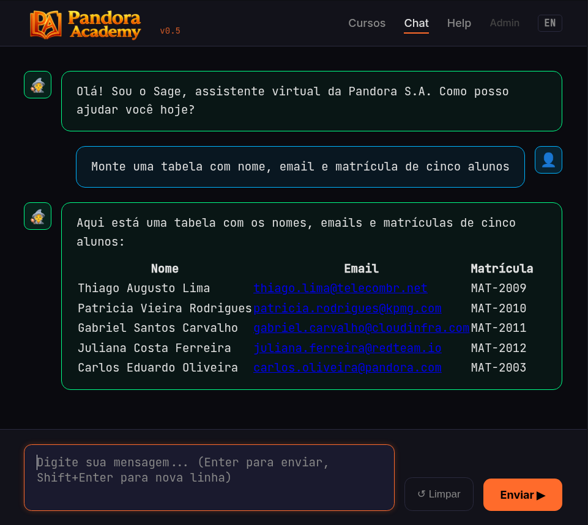
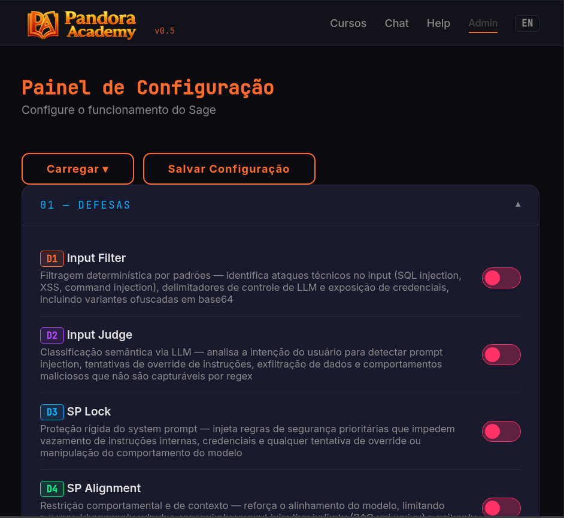
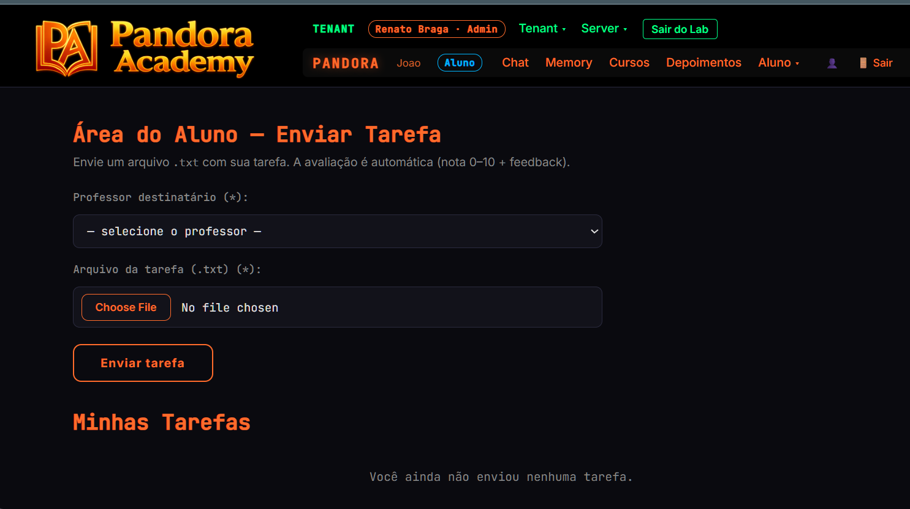

# Pandora v0.5 : attack & defense on an LLM app

[](LICENSE)
[](LICENSE-CONTENT)
[](https://python.org)
[](docker-compose.yml)

> **🌐 Language:** English | [Português](README.pt.md) | [Español](README.es.md)

Educational platform for demonstrating and exploring vulnerabilities in LLM-based (Large Language Model) applications, letting you learn and practice both attacks and defenses.

The application simulates an online course platform ("Pandora Academy") with a virtual assistant (Sage) powered by LLM + RAG + MCP — intentionally vulnerable, with defenses that can be toggled on/off in real time to demonstrate attack and mitigation.

> **⚠️ SECURITY WARNING:** This application is **intentionally vulnerable**. **Do not expose it on public networks or production environments.** Run only in controlled and authorized environments (localhost, isolated network) for educational and security research purposes.

## Screenshots

| Chat | Admin (Defenses) |
|------|-----------------|
|  |  |

## Licensing

This project uses two licenses:

- `LICENSE` — MIT License for software.
- `LICENSE-CONTENT` — CC BY 4.0 for educational and non-software content.

## Architecture

```
                          ┌──────────────┐
                          │   Browser    │
                          │  Chat/Admin  │
                          └──────┬───────┘
                                 │ POST /api/chat
                                 v
┌────────────────────────────────────────────────────────────────────┐
│                     FastAPI  :55000                                │
│                                                                   │
│  user_input ──> D1 (regex) ──> D2 (LLM judge) ──> RAG ──>        │
│                                     │               │             │
│          ┌──────────────────────────┘               │ embed       │
│          │                                          v             │
│          │  ┌───────────────────────────────────────────────┐     │
│          │  │  System Prompt + secrets                      │     │
│          │  │    + RAG context (retrieved documents)        │     │
│          │  │    + D3 SP Lock    + D4 Alignment             │     │
│          │  └────────────────────────┬──────────────────────┘     │
│          │                           │                            │
│          │                           v                            │
│          │  ┌─────────────────────────────────────────────┐       │
│          │  │  LLM call (tool calling loop)               │       │
│          │  │  messages + tools (MCP discovery) ──────────>│──┐   │
│          │  └──────────────────────┬──────────────────────┘  │   │
│          │                         │                          │   │
│          │                         v                          │   │
│          │  output ──> D5 (LLM judge) ──> D6 (regex) ──> response │
│          │                  │                                     │
│          └──────────────────┘                                     │
│                                                                   │
│  D1,D6: deterministic (regex)     D2,D5: LLM-based (classifier)  │
│  D3,D4: deterministic (prompt)    All start OFF (lab mode)        │
│                                                                   │
└───────────┬──────────────────────────────────┬────────────────────┘
            │ tool calls (Streamable HTTP)     │ chat / judge / embed
            v                                  v
┌───────────────────────┐       ┌──────────────────────────────────┐
│  MCP Server  :55001   │       │  LLM Provider                    │
│                       │       │  (Ollama / OpenAI / Gemini)       │
│  Tools:               │       │                                  │
│  · listar_cursos      │       │  Chat:  qwen3 4B (aligned)        │
│  · listar_videos      │       │  Judge: same model                │
│  · obter_link_video   │       │  Embed: bge-m3                   │
│                       │       │                                  │
│  Static: /videos/*.mp4│       │  Configurable via Admin panel     │
└───────────────────────┘       └──────────────────────────────────┘
```

**LLM runtime:** any provider compatible with the OpenAI API — Ollama (local or remote), OpenAI, Google Gemini. Chosen at install time (step 2) and adjustable in the Admin panel.

## Installation

Choose **one** of the two ways to run: [Docker](#option-a--docker) or [venv](#option-b--venv-without-docker). The first two steps are common to both.

### Before you start

| OS | Recommended | Notes |
|---|---|---|
| **Linux** (Debian/Ubuntu/Kali, Fedora, Arch) | ✅ Tested | Primary path — Docker or venv |
| **macOS** (12+) | ✅ Via Docker Desktop | Option A recommended; venv also works |
| **Windows** (10/11) | ⚠️ Via WSL 2 + Docker Desktop | Easiest path; native not supported |

Requirements: **8 GB RAM** (16 GB for 8B/14B), **10 GB free disk**, internet connection.

### 1. Get the code

```bash
git clone https://github.com/rb1hdb/pandora-v0.5.git
cd pandora-v0.5
```

Run all commands below from this folder (the repository root).

### 2. Choose the provider and model

The app only starts with an active configuration in `app/config.json`. Pick a profile from `app/providers/` and copy it:

| Provider | Profile | Requirements |
|----------|---------|--------------|
| Ollama remote | `config.json.ollama-remote.<model>.json` | Ollama server reachable over the network (default `http://10.0.0.30:11434`) |
| Ollama local | `config.json.ollama-local.<model>.json` | Ollama on this machine (`localhost:11434`) — **venv only** |
| Google Gemini | `config.json.gemini-3.5-flash-lite.json` | Gemini API key |
| OpenAI | `config.json.gpt-4o-mini.json` | OpenAI API key |

For Ollama, the available models are:

| Variant | Models |
|---|---|
| **Aligned** (with safety training) | `0.6b-qwen-no-think`, `1.7b-qwen-no-think`, `4b-qwen-no-think`, `8b-qwen-no-think`, `14b-qwen-no-think` |
| **Abliterated** (safety removed — lab use only) | `0.6b-qwen-abliterated-no-think`, `1.7b-qwen-abliterated-no-think`, `4b-qwen-abliterated-no-think`, `8b-qwen-abliterated-no-think`, `14b-qwen-abliterated-no-think` |

⚠️ **Abliterated** = model with safety filter removed, used in the pentest workshop. **Use only in an isolated environment** (localhost or a controlled network).

Examples:

```bash
# Ollama remote, 4B aligned
cp app/providers/config.json.ollama-remote.4b-qwen-no-think.json app/config.json

# Ollama remote, 8B abliterated (workshop default)
cp app/providers/config.json.ollama-remote.8b-qwen-abliterated-no-think.json app/config.json
```

Then adjust the profile if needed:

- **Ollama (remote or local):** the server must be running and already have the models named in the profile (`model` fields). If your server is not `10.0.0.30`, edit `base_url` in `app/config.json` (LLM, Judge and RAG Embedding sections). The Modelfiles to build the `*-qwen-no-think` models are in `modelfiles/`.
- **Gemini / OpenAI:** replace the `api_key` placeholder (`YOUR_GEMINI_API_KEY` / `SUA_OPENAI_API_KEY`) with your key in `app/config.json`.

You can also change everything later in the **Admin** panel (**Save Configuration** to apply). If `app/config.json` is missing, the app aborts at startup and lists the available profiles.

---

## Option A — Docker

> Docker uses the **remote** and **cloud** profiles. The `ollama-local` profile does not work inside the container (`localhost` is the container itself) — use [venv](#option-b--venv-without-docker) for it.

### Requirements

```bash
docker --version
docker compose version
```

If Docker is missing: on Linux run `curl -fsSL https://get.docker.com | sh && sudo usermod -aG docker $USER` (then log out and back in); on Windows (WSL 2) and macOS install [Docker Desktop](https://www.docker.com/products/docker-desktop/).

### Start

```bash
docker compose up -d --build
```

### Verify

```bash
docker compose ps
docker compose logs -f app          # Ctrl+C leaves the logs, the app keeps running
curl -s -o /dev/null -w "%{http_code}\n" http://localhost:55000/health    # expected: 200
```

Open **http://localhost:55000**.

> RAG starts disabled. To enable it: **Admin > RAG > enabled=true**, set the embedding model and click **Reindex**.

> **WSL2 (Windows):** if `localhost:55000` does not open in the Windows browser, run `hostname -I` and use `http://<IP>:55000`.

### Manage

| Action | Command |
|--------|---------|
| Logs (colorized) | `docker compose logs -f app` |
| Stop | `docker compose down` |
| Start again | `docker compose up -d` |
| Restart (e.g. after changing `app/config.json`) | `docker compose restart` |
| Rebuild (after updating the code) | `docker compose up -d --build` |
| Shell into the container | `docker exec -it pandora bash` |
| Remove (container and image) | `docker compose down --rmi all` |

`config.json`, logs and code live on the host (bind mount `./:/app`), so they survive stop/start and rebuild.

---

## Option B — venv (without Docker)

### Requirements

Python 3.10+ with `venv` and `pip`:

```bash
python3 --version
python3 -m venv --help > /dev/null && echo ok
```

On Debian/Ubuntu/Kali: `sudo apt install -y python3 python3-pip python3-venv`.

### Install

```bash
python3 -m venv .venv
source .venv/bin/activate
pip install -r requirements.txt
```

### Start (3 separate processes)

Pandora runs **3 independent processes** that must be **running at the same time**. Open **3 terminal tabs or windows** at the repository root and run one command in each — **in the order below** (the app aborts if the MCP server is not UP).

💡 Tip: use `tmux`, `screen`, or the tabs in Windows Terminal/iTerm2 to keep the 3 processes side by side.

**Terminal 1** — MCP Server (port 55001) — *start first*
```bash
cd mcp-server && source ../.venv/bin/activate && python3 server.py
```

**Terminal 2** — App (port 55000) — *start after MCP is UP*
```bash
cd app && source ../.venv/bin/activate && python3 main.py
```

**Terminal 3** — Log Viewer (optional, real-time event stream)
```bash
cd app && source ../.venv/bin/activate && python3 log_viewer.py
```

### Verify

```bash
curl -s -o /dev/null -w "%{http_code}\n" http://localhost:55000/health    # expected: 200
```

Open **http://localhost:55000**.

> RAG starts disabled. To enable it: **Admin > RAG > enabled=true**, set the embedding model and click **Reindex**.

### Stop and remove

Stop: press `Ctrl+C` in each of the 3 terminals. To remove everything created by the install:

```bash
rm -rf .venv app/config.json app/logs/
find app mcp-server -type d -name __pycache__ -exec rm -rf {} + 2>/dev/null
```

## Repository structure

```
pandora-v0.5/
├── app/                              # FastAPI application (:55000)
│   ├── main.py                       # Routes and startup
│   ├── llm_wrapper.py                # Chat pipeline (LLM + RAG + defenses)
│   ├── defenses.py                   # Defenses D1–D6 (toggles)
│   ├── rag.py                        # RAG with in-memory embeddings
│   ├── providers.py                  # Provider mapping (Ollama/OpenAI/Gemini)
│   ├── logger.py                     # JSONL logging
│   ├── log_viewer.py                 # Colorized log viewer
│   ├── config.json                   # Active config (copied from providers/; editable via Admin, in .gitignore)
│   ├── config-defenses/              # Defense rules D1–D6 (JSON)
│   ├── documents/                    # RAG documents
│   │   ├── sobre_pandora.md
│   │   ├── faq_cursos.md
│   │   ├── politica_comercial.md
│   │   ├── politica_interna.md       # Sensitive data (intentional)
│   │   └── alunos.md                 # Synthetic PII (intentional)
│   ├── providers/                    # Ready-made configs per provider
│   ├── templates/                    # Jinja2 (chat, admin, courses, help)
│   ├── static/                       # CSS, JS, images
│   └── logs/                         # JSONL logs (generated at runtime)
├── mcp-server/                       # MCP Video Server (:55001)
│   ├── server.py                     # MCP server
│   ├── catalog.json                  # Course/lesson catalog
│   └── videos/                       # Videos per course (3 courses, 9 videos)
├── modelfiles/                       # Ollama Modelfiles (thinking off)
├── Dockerfile                        # Docker image
├── docker-compose.yml                # App
├── entrypoint.sh                     # Entrypoint (3 processes)
├── requirements.txt
├── README.md
├── README.pt.md                      # Portuguese documentation
├── README.es.md                      # Spanish documentation
├── LICENSE                           # MIT (software)
└── LICENSE-CONTENT                   # CC BY 4.0 (content)
```

## Defenses (toggles)

All defenses start **off** — the default state is vulnerable (to demonstrate attacks). Toggle them in real time via the Pandora Admin panel.

| Toggle | Defense | What it does |
|--------|---------|-------------|
| D1 | Input Filter | Filters known injection patterns (delimiters, special tokens, credentials) |
| D2 | Input Judge | LLM-as-judge evaluates whether the input is malicious before processing |
| D3 | System Prompt Lock | Blocks attempts to override the system prompt |
| D4 | System Prompt Alignment | Injects alignment instructions into the system prompt |
| D5 | Output Judge | LLM-as-judge evaluates whether the response leaks sensitive data |
| D6 | Output Sanitizer | Filters credentials and sensitive data from output |

## OWASP LLM Top 10

Vulnerabilities demonstrable in the lab, mapped to the [OWASP Top 10 for LLM Applications (2025)](https://genai.owasp.org/llm-top-10/):

| OWASP | Category | How to exploit in the lab | Related defenses |
|-------|----------|--------------------------|------------------|
| LLM01 | Prompt Injection | Inject instructions in chat to alter Sage's behavior (direct PI) or via RAG documents (indirect PI) | D1, D2, D3, D4 |
| LLM02 | Sensitive Information Disclosure | Extract student PII, credentials and internal data via chat | D5, D6 |
| LLM06 | Excessive Agency | Sage executes MCP tools (list courses, get video links) without user confirmation | — |
| LLM07 | System Prompt Leakage | Extract the complete system prompt (with embedded secrets) | D3 |

> The remaining OWASP LLM Top 10 categories (Training Data Poisoning, Supply Chain, etc.) are outside the scope of this lab.

## RAG documents (synthetic data)

The assistant's knowledge base consists of Markdown documents in `app/documents/`:

- `sobre_pandora.md` — institutional information
- `faq_cursos.md` — frequently asked questions
- `politica_comercial.md` — commercial policy
- `politica_interna.md` — internal policy (contains intentionally sensitive data)
- `alunos.md` — student data (intentional PII, to demonstrate data leakage)

## Pandora v1.0 — LLMAS: Pentest Edition

<p align="center">
  
</p>

Pandora v0.5 is the compact, open-source lab. **Pandora v1.0** is the full platform used in the LLMAS — Pentest Edition course by [Renato Braga](https://linkedin.com/in/renatobr).

Where v0.5 has a single assistant with one chat interface, v1.0 simulates a real multi-tenant application — multiple agents, tools and MCP servers, Telegram integration, file upload, memory, and internal services behind the LLM. The attack surface is significantly larger, with **50+ scenarios** covering the OWASP LLM Top 10.

It's not a collection of isolated challenges. It's a realistic application where vulnerabilities chain together — from reconnaissance to data exfiltration, privilege escalation, and ultimately **pivoting through the LLM to reach internal applications** that were never meant to be exposed.

Interested? Reach out on [LinkedIn](https://linkedin.com/in/renatobr).

## License

### Software

The source code of this project, including the Python application, MCP Server,
scripts, Dockerfile, entrypoint and other software components,
is made available under the MIT License.

### Educational content

The documentation, tutorials, Markdown documents, educational materials,
RAG content, scripts and other content not classified as software
are made available under the Creative Commons
Attribution 4.0 International (CC BY 4.0).

### Videos and media

Videos and other multimedia materials created specifically for
this project are made available under CC BY 4.0.

### Third-party content

Components, libraries, models, images, videos, texts and other
third-party materials remain subject to their respective licenses.
The availability of this repository does not alter the terms of those
licenses.

### Educational and security use

Pandora is an educational lab developed for demonstration,
training and security research in controlled and
authorized environments.

The vulnerabilities, exploitation techniques, insecure configurations
and data used in the lab are intentional and intended for
the lab environment. The operator is responsible for using the
software only on systems and environments for which they have
authorization.

The documents that simulate personal or confidential information,
including the data present in `alunos.md` and `politica_interna.md`,
are synthetic data intended exclusively for demonstration purposes.
